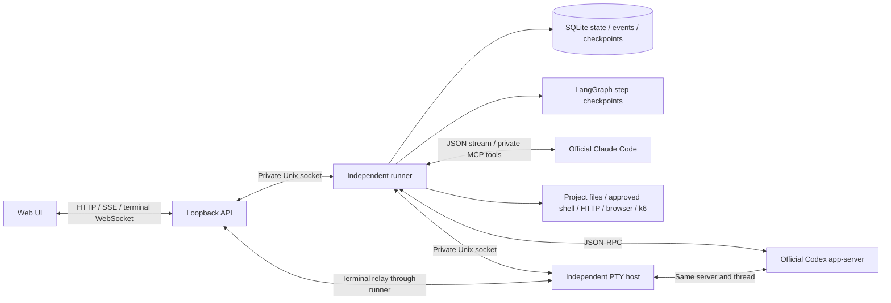

# Architecture

| Path | Responsibility |
| --- | --- |
| `apps/web` | The existing visual design, forms, flow canvas, sessions, and outputs |
| `apps/server` | Loopback HTTP, browser session and CSRF checks, SSE, terminal relay |
| `apps/runner` | Process entry points, sole database writer, MCP bridge, PTY host |
| `packages/contracts` | Validated settings, presets, projects, runs, and output types |
| `packages/engine` | Workflow, providers, approvals, skills, project environments, tools, persistence |

The existing DOM-based UI and canvas are retained. Replacing them with a UI framework is not required to reuse the API and engine in a future desktop shell. LangGraph owns step checkpoints. Official CLIs own their agent loops.

## State and identity

A Studio run ID, Studio step/session ID, provider thread ID, provider turn ID, connection generation, terminal ID, and event sequence have separate meanings. Starting a task snapshots the project, flow, presets, permissions, and skills. Later settings edits cannot alter that run.

The run also freezes root `AGENTS.md` and `CLAUDE.md` instructions. A worktree uses its selected revision's file when present and falls back to the source project's local file when Git did not include it. Later source edits do not change the saved instructions.

SQLite transactions save a run and its event sequence together. Command IDs deduplicate identical requests. A pending command after a crash is uncertain and cannot be replayed automatically. This does not promise exactly-once behavior from model providers or external commands.

SSE reconnects from a saved sequence and sends current persisted run state. Full conversations are loaded when a task is opened; the history list contains summaries. Logs do not contain hidden model reasoning.

## Context and evidence

Each role starts a fresh session. Prompts contain the task, role contract, selected instructions, code fingerprint, and bounded prior outputs. Agents can retrieve complete earlier artifacts in pages. A skill version hashes its instructions and allowed supporting files. A changed source requires an explicit binding update before a new run.

Tool execution records inputs, outputs, success, time, and a code fingerprint. Screenshots and diffs are attached separately. Agents must return a structured handoff. Planner completion requires both a plan and a QA sheet. Backend QA requires execution evidence; frontend QA requires browser evidence and a screenshot. These gates confirm evidence exists, not that arbitrary agent conclusions are correct. Reports remain available for human review.

## Control and recovery

Only one run executes in a workspace. Pause takes effect between steps. A terminal can take control only at a safe boundary without an active turn or pending approval. Terminal input uses the same server and thread, and automatic steps remain paused. Before returning control, Studio checks for active provider turns and marks evidence stale if files changed.

The runner persists across UI/API disconnects. After runner failure, recovery reads the exact saved thread and turn instead of resending the prompt. Wrong identity, changed project, incomplete evidence, or unknown turn status stops recovery. Claude interrupted turns and uncertain terminal ownership require inspection and a new run; no provider writes are replayed.
